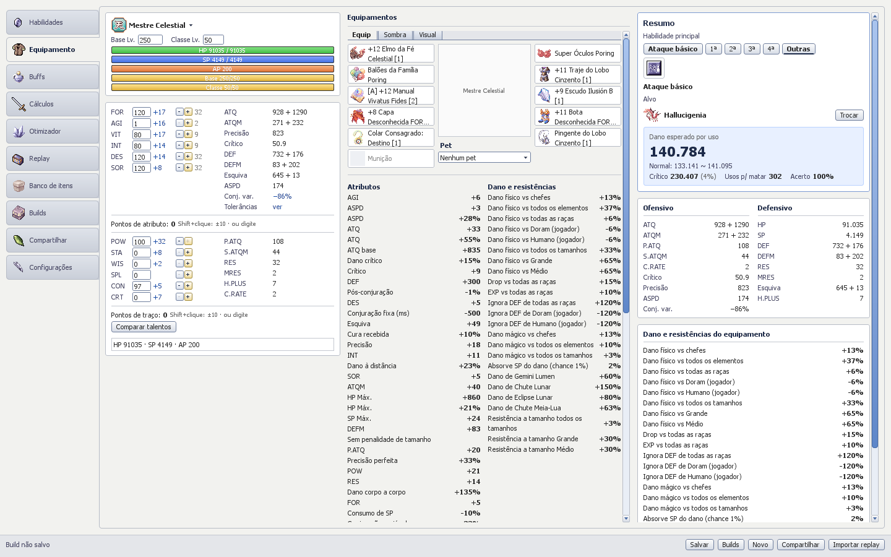
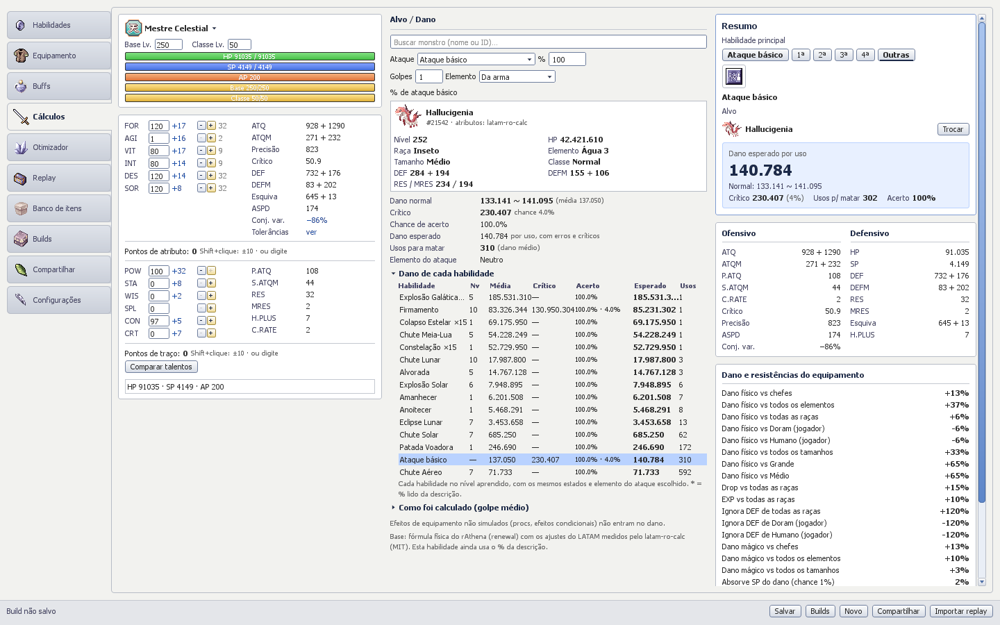
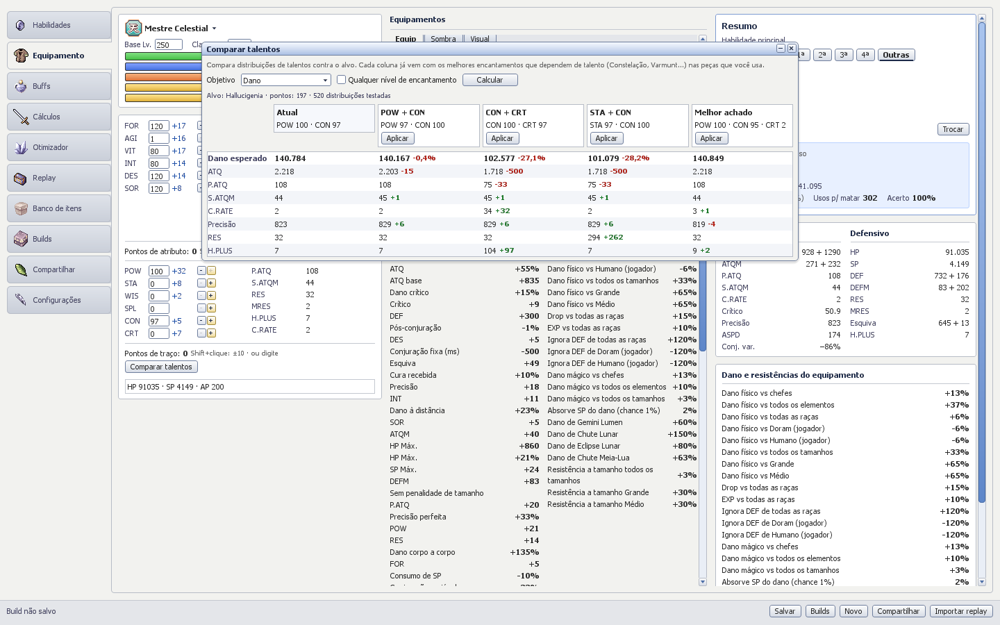
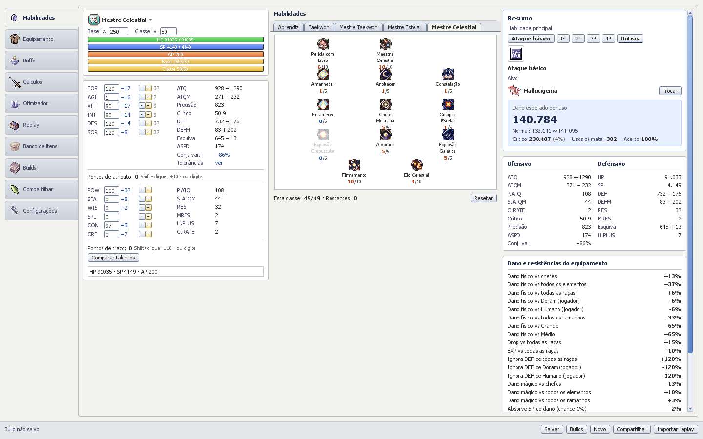

[Português](README.md) · **English**

# Ragnarok of Building

**Put together your Ragnarok Online LATAM build, see the damage and find out what to improve.**

## [▶️ Open the simulator](https://ragnarok-of-building.github.io/rob/)

Runs in the browser, nothing to install · in Portuguese, English and Spanish

## What it does

- **The whole build:** stats, traits, skill tree, equipment, cards, enchants, refine, grade, shadow gear, costumes, ammo and pet.
- **Damage against any monster in the catalog:** normal, critical, hit chance and hits to kill, with a table of your skills.
- **Replay import (`.rrf`):** reads the recorded character and sums up the recording's damage.
- **Optimizer:** tries items, cards and enchants and shows what each swap gains.
- **Best card:** ranks the options for a slot by damage or defense, counting sets.
- **Comparisons:** the ↔ button of every equipment slot compares another piece right there, several at once, with the damage now → new in the Summary; also items side by side, sets (cards included) and trait distributions.
- **Share:** a link or a code to send to a friend.
- **LATAM data:** items, texts and skills come from the LATAM client.

| Damage | Compare traits |
|---|---|
|  |  |

Skill tree

## How to use it

1. Open **[ragnarok-of-building.github.io/rob/](https://ragnarok-of-building.github.io/rob/)** in Chrome, Edge or Firefox, preferably on a computer.
2. Pick your class or click **Import replay**.

You don't need to install anything or have the game. Builds are kept in this browser; to take them to another one, use **Saved builds (Alt+C) → Export**, then **Import** in the other browser. To send a build to someone, use **Share → Link**. Press **Alt+H** to see the shortcuts.

The language is chosen in the settings; the screenshots here are in Portuguese.

> **Used the Windows program?** It has been discontinued, and new features now ship only on the site. To bring your builds over, open **Saved builds (Alt+C) → Import** on the site and pick the `builds.json` in the program's folder.

## Does the damage match the game?

The formulas come from latam-ro-calc, bROWiki and rAthena, and are checked against replays from the LATAM server. Some skills already match the recording; others still need more data. This is a **beta**.

Found a wrong number? [Open an issue](../../issues) with the **replay (`.rrf`)** and a screenshot of the **Stats window (Alt+A)** with your traits.

## For developers

Written in Go with [Gio](https://gioui.org), compiled to WebAssembly and published on GitHub Pages. How to build, import the data, regenerate the formulas and publish: [docs/DESENVOLVIMENTO.md](docs/DESENVOLVIMENTO.md).

## Contributors

- **[edudebortoli](https://github.com/edudebortoli)**: the Linux version and the AppImage package ([PR #2](../../pull/2)).

Want to help? Issues and pull requests are welcome.

## Credits

- **[latam-ro-calc](https://github.com/adsonpleal/latam-ro-calc)** and **[rrfparser](https://github.com/adsonpleal/rrfparser)**, by Adson Leal (MIT): LATAM formulas and monsters, and the reference for the replay format.
- **[bROWiki](https://browiki.org)**: skill tables, used to check the formulas.
- **[rAthena](https://github.com/rathena/rathena)** (GPL-3.0): class, item and monster tables.
- **[Divine Pride](https://www.divine-pride.net)**: the stats of some monsters.

What comes from each source is detailed in [docs/DESENVOLVIMENTO.md](docs/DESENVOLVIMENTO.md#credits).

## License

The code is under the [MIT license](LICENSE). The game's data and images are not covered by it: Ragnarok Online is © Gravity Co., Ltd. This is a fan project, not affiliated with Gravity.
