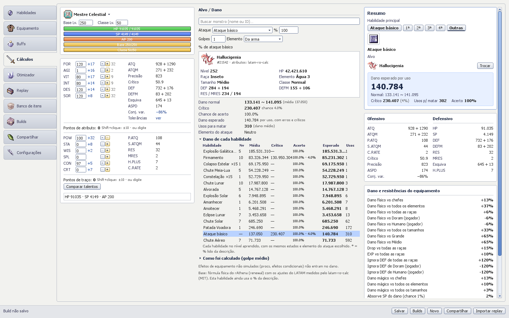
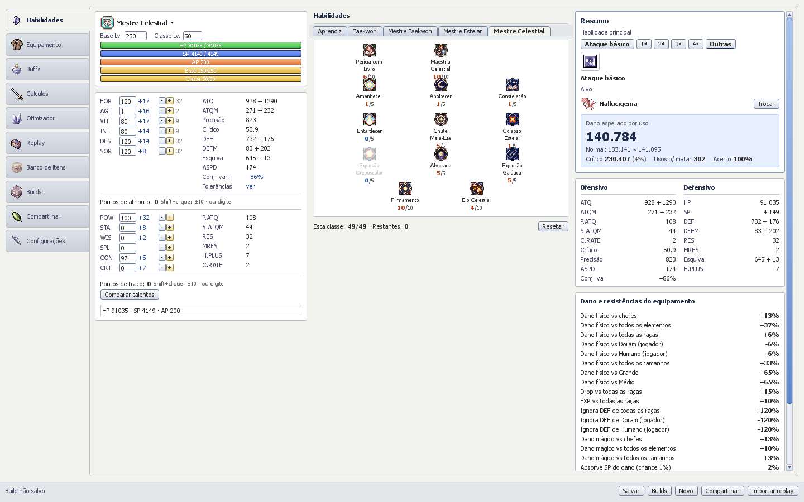

**Português** · [English](README.en.md)

# Ragnarok of Building

**Monte sua build de Ragnarok Online LATAM, veja o dano e descubra o que melhorar.**

## [▶️ Abrir o simulador](https://ragnarok-of-building.github.io/rob/)

Roda no navegador, sem instalar nada · em português, inglês e espanhol

## O que ele faz

- **Build completa:** atributos, talentos, árvore de habilidades, equipamentos, cartas, encantamentos, refino, grau, sombras, visuais, munição e pet.
- **Dano contra qualquer monstro do catálogo:** normal, crítico, chance de acerto e usos para matar, com a tabela das suas habilidades.
- **Importa replay (`.rrf`):** lê o personagem gravado e resume o dano da gravação.
- **Otimizador:** testa itens, cartas e encantamentos e mostra o ganho de cada troca.
- **Melhor carta:** ordena as opções de uma posição por dano ou defesa, contando conjuntos.
- **Comparações:** o botão ↔ de cada slot do equipamento compara outra peça ali mesmo, várias de uma vez, com o dano atual → novo no Resumo; também itens lado a lado, conjuntos (com cartas) e distribuições de talentos.
- **Compartilhar:** link ou código para mandar a um amigo.
- **Dados do LATAM:** itens, textos e habilidades vêm do cliente LATAM.

| Cálculo de dano | Comparar talentos |
|---|---|
|  |  |

Árvore de habilidades

## Como usar

1. Abra **[ragnarok-of-building.github.io/rob/](https://ragnarok-of-building.github.io/rob/)** no Chrome, Edge ou Firefox, de preferência no computador.
2. Escolha sua classe ou clique em **Importar replay**.

Não precisa instalar nada nem ter o jogo. Os builds ficam guardados neste navegador; para levá-los a outro, use **Builds salvos (Alt+C) → Exportar** e depois **Importar** no outro. Para mandar um build a alguém, use **Compartilhar → Link**. Aperte **Alt+H** para ver os atalhos.

> **Usava o programa para Windows?** Ele foi descontinuado: as novidades agora saem só no site. Para trazer seus builds, abra **Builds salvos (Alt+C) → Importar** no site e escolha o `builds.json` que fica na pasta do programa.

## O dano confere com o jogo?

As fórmulas vêm do latam-ro-calc, do bROWiki e do rAthena, e são conferidas com replays do servidor LATAM. Algumas habilidades já batem com a gravação; outras ainda precisam de mais dados. É uma versão **beta**.

Achou um dano errado? [Abra uma issue](../../issues) com o **replay (`.rrf`)** e um print dos **atributos (Alt+A)** com os talentos.

## Para quem programa

Feito em Go, com [Gio](https://gioui.org), compilado para WebAssembly e publicado no GitHub Pages. Como compilar, importar os dados, regenerar as fórmulas e publicar uma versão: [docs/DESENVOLVIMENTO.md](docs/DESENVOLVIMENTO.md) (em inglês).

## Quem contribuiu

- **[edudebortoli](https://github.com/edudebortoli)**: versão para Linux e o pacote AppImage ([PR #2](../../pull/2)).

Quer ajudar? Issues e pull requests são bem-vindos.

## Créditos

- **[latam-ro-calc](https://github.com/adsonpleal/latam-ro-calc)** e **[rrfparser](https://github.com/adsonpleal/rrfparser)**, de Adson Leal (MIT): fórmulas e monstros do LATAM, e referência do formato de replay.
- **[bROWiki](https://browiki.org)**: tabelas das habilidades, usadas para conferir as fórmulas.
- **[rAthena](https://github.com/rathena/rathena)** (GPL-3.0): tabelas de classes, itens e monstros.
- **[Divine Pride](https://www.divine-pride.net)**: atributos de alguns monstros.

O que vem de cada fonte está detalhado em [docs/DESENVOLVIMENTO.md](docs/DESENVOLVIMENTO.md#credits).

## Licença

O código está sob a [licença MIT](LICENSE). Os dados e as imagens do jogo não fazem parte dela: Ragnarok Online é © Gravity Co., Ltd. Este é um projeto de fãs, sem ligação com a Gravity.
